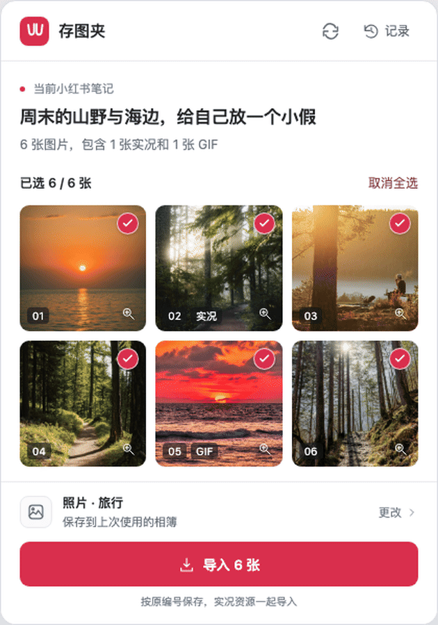
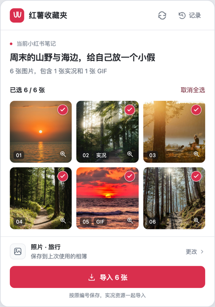
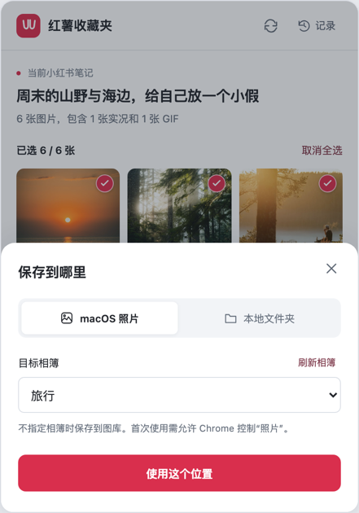
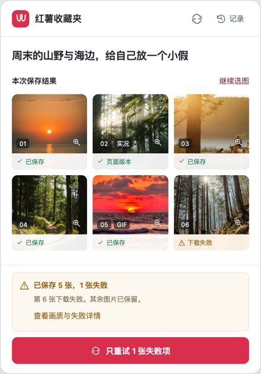
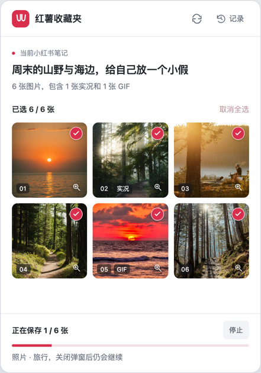
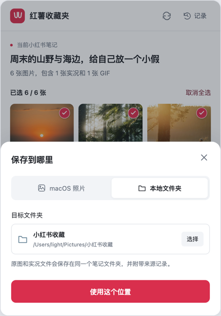

# 存图夹

**把小红书和 X（原 Twitter）网页版的图片、GIF、视频和实况照片，一次性带回 Mac「照片」或本地文件夹。**


[中文](#中文) · [English](#english)



一个 Chrome 扩展 + macOS 本机连接器。打开网页版小红书笔记、X 帖子或文章，扩展列出页面里的图片、GIF 和视频；勾选后下载原文件，导入「照片」（可指定相簿）或导出到本地文件夹。没有远程服务器、没有账号、没有遥测——所有处理都在你自己的 Mac 上完成。

---

# 中文

> 下方界面截图来自项目的交互设计原型，使用演示数据；实际操作只影响你自己的照片图库或文件夹。

## 功能

- **拿到的不是缩略图。** 连接器剥离 CDN 的缩放、格式转换和水印后缀，回源下载原始上传文件。
- **GIF 保持动图。** 按文件真实字节判断格式，不依赖扩展名或 Content-Type。
- **实况照片真的会动。** 同时取回静态帧与短视频，写入相同的 Apple Content Identifier 后作为一对资源导入，「照片」里能按住播放。
- **X 帖子与文章。** 页面里的 WebP 预览会换成同图 JPEG 原图；animated GIF 按 X 实际提供的无音频 MP4 保存；网页只暴露 `blob:` 或全屏浮层时，从 X 的公开 syndication 数据取回原图或直链 MP4。
- **两种保存位置。** 默认导入「照片」并可指定相簿；也可每次导出到以笔记标题命名的独立文件夹，不覆盖旧文件。
- **失败可定位、可重试。** 结果标在对应图片上，「查看详情」给出每张的失败原因和画质回退说明，「重试失败项」只处理失败项。
- **保存历史。** 记录最近 100 次成功保存，可回看保存位置、媒体编号和原页链接；只存本机，可随时清除。
- **后台执行。** 保存任务在后台进行，关闭弹窗不中断；重新打开可查看进度、停止或继续选图。
- **批量与并行。** 单次最多 30 个媒体；连接器并行下载（4 路）并批量导入（每 8 张一次 Apple Event），明显缩短多图保存时间。
- **五种外观。** 顶部调色盘可切换原生轻巧、珊瑚随收、暗房精选、林间藏品和轻快贴纸；选择保存在本机。

### 外观主题

弹窗右上角的调色盘用于切换外观，默认使用「珊瑚随收」。

| 主题 | 视觉特点 |
| --- | --- |
| 原生轻巧 | 浅灰蓝、紧凑圆角，接近系统工具栏 |
| 珊瑚随收（默认） | 暖白底、珊瑚红强调色、胶囊形主按钮 |
| 暗房精选 | 深色背景、冷蓝高光、方形边角 |
| 林间藏品 | 深绿顶栏、米白内容、衬线标题 |
| 轻快贴纸 | 黄色顶栏、粗黑描边、硬阴影 |

切换只改变颜色、字体、圆角和阴影，不会重置已选媒体、保存位置或正在进行的任务。选择写入本机 Chrome 存储，下次打开弹窗继续沿用。全部 10 套外观与交互探索见 [设计预览](design-previews/ui-explorations/index.html)。

### 界面

<table>
  <tr>
    <td></td>
    <td></td>
    <td></td>
  </tr>
  <tr>
    <td align="center">选图：默认全选，可放大预览</td>
    <td align="center">保存位置：相簿或本地文件夹</td>
    <td align="center">结果：逐张标记，失败可重试</td>
  </tr>
</table>

<table>
  <tr>
    <td></td>
    <td></td>
    <td></td>
  </tr>
  <tr>
    <td align="center">进度：可停止，关闭弹窗后继续</td>
    <td align="center">文件夹：每个笔记一个子目录</td>
    <td align="center">记录：最近 100 次，仅此设备</td>
  </tr>
</table>

## 支持的页面

| 页面 | 可保存 | 说明 |
| --- | --- | --- |
| 小红书图文笔记 | 原图、GIF、实况照片 | 从笔记结构与页面状态读取，只取当前笔记 |
| X 帖子 | 图片、GIF、普通视频 | GIF 通常以 MP4 提供；视频需为直接 MP4 |
| X 文章 | 图片、GIF、普通视频 | 支持文章实体；页面 DOM 无媒体时回退 syndication |
| X 全屏图片浮层 | 原图 | 浮层不进入帖子 DOM 时从公开数据恢复 |
| 本地文件夹 | 普通图片、GIF、实况配对、视频 | 实况保存为同名图片 + `.mov`，文件夹中不播放实况 |

暂不支持：HLS（`.m3u8`）视频、需要登录才能看到的受限媒体、超过大小上限的文件。

## 工作方式

Chrome 扩展不能直接写 macOS 照片图库，所以走 Chrome 官方的 Native Messaging：


| 组件 | 文件 | 职责 |
| --- | --- | --- |
| 扩展界面 | `popup.html` `popup.css` `popup.js` | 列出媒体、选择目的地、触发保存、展示结果与历史 |
| 后台任务 | `background.js` | 保持本机连接，保存任务状态与结果，轮转历史 |
| 内容脚本 | `content.js` | 收集当前笔记或帖子，合并页面状态与可见 DOM，补全视频直链后只返回可保存的媒体 |
| 解析层 | `note-parser.js` | 共用小红书/X 结构化解析，只选择当前笔记或帖子 |
| 本机连接器 | `native-host/host.py` | 校验地址、下载原文件、嗅探格式、并行下载、导入或导出 |
| 实况配对 | `native-host/live-photo-helper.swift` | 为静态帧与 MOV 写入同一 Content Identifier |
| 纯快捷指令版 | `ios-shortcut/` | iPhone 上用同一个快捷指令保存小红书图片与 X 图片、GIF、MP4 |

连接器只接受来自本扩展固定 ID `doklnnbjpnipnicbiecefbchkhmckcbm` 的消息，并独立校验域名白名单：小红书及其图片 CDN（`*.xiaohongshu.com`、`*.xhscdn.com`、`*.xhscdn.net`），以及 X 的 `x.com`、`twitter.com`、`pbs.twimg.com`、`video.twimg.com`。即使扩展被篡改，也无法让它去下载别处的文件。

## 安装

需要 macOS 13+、Chrome 109+、Python 3.10+。

1. 从 [Releases](https://github.com/FlyTOmeLight/web-media-to-photos/releases/latest) 下载 `web-media-to-photos-版本号.zip`，解压得到项目文件夹。
2. 右键 `native-host/install.command`，选择「打开」，确认运行。
3. 打开 `chrome://extensions`，开启「开发者模式」，点「加载已解压的扩展程序」，选择项目文件夹。
4. 确认扩展 ID 是 `doklnnbjpnipnicbiecefbchkhmckcbm`。

发布包自带 Apple Silicon / Intel 通用实况组件，无需开发工具。GitHub 自动生成的 Source code 包或 git checkout 会在安装时用 `swiftc` 编译组件，需要 Apple 命令行开发工具（`xcode-select --install`）。缺少 Python 时可通过 Homebrew 安装：`brew install python`。

安装脚本先在临时目录完成全部准备，成功后才替换 `~/Library/Application Support/存图夹/` 和 Native Messaging 清单；失败不会破坏已有安装。连接器使用安装时选定的 Python 解释器启动。

> **更新已有安装：** 更新项目文件后重新运行 `native-host/install.command`，再到 `chrome://extensions` 刷新扩展。只有扩展 ID 与上文不一致时才需要移除重装。

> **从旧版「红薯收藏夹」升级：** 重新运行 `native-host/install.command` 后，安装器会把旧安装目录和旧 Native Messaging 清单移到废纸篓；扩展 ID 不变，保存历史与偏好都会保留。

首次读取相簿或导入时，macOS 会询问 Chrome 是否可以控制「照片」，选择**允许**。

## 使用

1. 在网页版小红书打开一篇笔记，或在 X 打开帖子/文章，**等待媒体加载完成**。
2. 点击工具栏上的「存图夹」，扩展读取当前页面里的图片、GIF 和视频。
3. 勾选需要的媒体（默认全选），点「导入 N 张」。

默认保存到「照片」图库。点底部的「更改」打开保存位置面板：读取并选择相簿，或切换到「本地文件夹」选择目录，点「使用这个位置」确认；关闭面板会放弃未确认的修改。

- **文件夹导出**：每次保存创建以笔记标题开头的独立子文件夹，并写入 `source.json` 记录标题、链接、成功编号、实际文件名和画质来源。普通图片与 GIF 保留原格式；实况照片保存为同名图片 + `.mov` 配对文件（如 `02.jpg` 与 `02.mov`）。
- **查看与重试**：每张图的结果标在缩略图上；「查看详情」列出失败原因与回退说明；「重试失败项」只处理失败媒体；「继续选图」回到选择状态。
- **导入未确认**：「照片」导入超时、返回部分数量或未返回有效结果时，缩略图会标为「导入未确认」。这些媒体不计入成功记录，也不进入「重试失败项」；请先检查「照片」，再决定是否重新保存，避免重复导入。
- **停止任务**：保存中可点「停止」。停止后不再开始新的下载或导入，已完成的文件保留；正在进行的一次系统导入或视频转换会先结束。
- **保存历史**：顶部「记录」打开历史页，按日期分组，可查看保存位置与媒体编号。清除记录不会删除已保存的照片。

单次最多 30 个媒体；单张图片上限 80 MB，视频上限 512 MB。系统文件夹选择器可能关闭弹窗；选好后再次点击扩展即可继续，勾选和保存位置会保留。

## 权限与隐私

| 权限 | 用途 |
| --- | --- |
| `activeTab` | 点击扩展时读取当前标签页 |
| `scripting` | 在页面主世界注入读取脚本 |
| `nativeMessaging` | 把选中的媒体地址交给本机连接器 |
| `storage` | 会话内保留勾选和任务状态；本机持久保存保存位置偏好、外观主题与最近 100 次成功记录 |
| `host_permissions` | 仅限小红书、其图片 CDN、X 相关域名与 X 的公开 syndication 地址 |

没有账号体系，不上传任何内容，不收集遥测。历史记录和偏好只保存在本机 Chrome 存储中。

## 常见问题

**提示「尚未安装照片连接器」或 Native host not found**
重新运行 `native-host/install.command`，确认扩展 ID 与上文一致，然后重启 Chrome。

**只找到封面**
先点开笔记详情并滑动图片让内容加载完成，再点弹窗右上角的刷新按钮。

**首次导入失败**
在「系统设置 → 隐私与安全性 → 自动化」中，允许 Chrome 控制「照片」。

**出现重复图片确认**
这是「照片」App 自己的重复检测，跳过或导入都可以。

**实况照片变成了静态图**
先重新运行 `native-host/install.command`，再刷新扩展。若仍如此，多半是这篇笔记本身没有向网页返回视频地址；结果里会明确提示「N 张仅保存静态图」。

**X 视频保存失败**
只有直接 MP4 可以保存，HLS（`.m3u8`）流不支持。找不到 MP4 的视频或 GIF 不会出现在媒体列表里；如果整篇帖子只剩这类媒体，会提示没有找到可保存的图片。请刷新 X 页面后重试，或改用页面提供的 MP4 版本。

**保存后找不到文件**
文件夹导出会新建一个以笔记标题命名的子目录；在弹窗结果里可以查看完整路径。

## 纯快捷指令版（iPhone，无需安装）

`ios-shortcut/` 的 2.0.0 版用同一个快捷指令处理小红书笔记和 X 帖子：接收系统分享内容，或在没有分享输入时读取剪贴板，识别平台并展开短链，按原帖编号与类型多选后才下载，保存到 iPhone「照片」。无需额外 App 或 Mac 连接器。

**能力边界：** 小红书保存图片、源页面提供的 GIF 和实况静态封面；X 保存原图及直接 MP4 中最高码率的视频，GIF 按 MP4 保存，仅 HLS 的媒体会跳过并提示。不支持 X 文章和引用帖媒体。14 项回归通过，macOS 系统「快捷指令」已完成双平台真实下载保存；已确认 iPhone 同步安装，用户反馈 X 图片保存完成。手机其他分支尚未逐项验证，详情见 [ios-shortcut/README.md](ios-shortcut/README.md)。

## 开发与验证

扩展是根目录下的纯 JS/HTML/CSS，无构建步骤；连接器是 Python 3.10 兼容的单文件脚本。

```sh
./scripts/check.command                                    # 本机完整检查：非浏览器检查 + ego lite 布局、工具栏与 E2E
node --test test_extension.cjs test_content.cjs            # 扩展回归
python3 -B -m unittest discover -s native-host -p 'test_*.py' -v   # 连接器测试
python3 -B scripts/check_popup_layout.py                   # ego lite 18 个弹窗布局场景
python3 -B scripts/check_toolbar_popup.py                  # ego lite 真实工具栏弹窗启动/重开
python3 -B scripts/check_e2e.py                            # ego lite 全链路 E2E：真实扩展 + 连接器写入临时文件夹
python3 -B scripts/check_ego_browser.py                    # 真实 X 页面媒体 smoke test
```

`check.command` 需要 Node.js 22+、Python 3.10+、ego lite 和 Apple 命令行开发工具。浏览器校验固定使用 ego lite，默认可执行文件是 `/Applications/ego lite.app/Contents/MacOS/ego lite`；其他位置用 `EGO_BROWSER=<路径>` 指定，会传给布局、工具栏和 E2E 三个脚本。设置 `SKIP_BROWSER_CHECKS=1` 会跳过这三项，并在末尾输出 `非浏览器检查通过；ego lite 浏览器检查已跳过。`

GitHub Actions 的 macOS runner 未配置 ego lite，因此 workflow 设置 `SKIP_BROWSER_CHECKS=1`：只运行非浏览器检查，布局、工具栏和 E2E 不运行，也不回退到 Chrome。

`check_e2e.py` 使用隔离的 ego lite 配置和本地网页/媒体夹具，验证小红书图片、GIF、实况照片、部分失败以及 X 图片保存到临时文件夹。测试使用弹窗页面和活动标签页适配层，连接器以唯一的临时标识注册到 ego lite 读取的 `~/Library/Application Support/Google/Chrome/NativeMessagingHosts` 并在结束后删除；它不验证真实网站、照片图库或工具栏弹窗。

1.9.0 使用连接器协议 4，区分导入成功、明确失败和结果未确认。从旧版本升级时请重新运行 `native-host/install.command`，然后重新加载扩展；版本不匹配时会在保存前提示更新。

`check_ego_browser.py` 用 ego lite 打开真实 X 页面检查媒体 DOM、原图 URL 归一化和白名单；可通过 `EGO_X_TEST_URL` 指定公开的 `/status/` 地址。未发现媒体时报告 skipped。

连接器把媒体以 256 KB 分块写入临时文件，图片全程不驻留内存；`python3 -B scripts/benchmark_download.py` 可复现分配测试（本机 80 MB 样本峰值约 0.65 MB）。下载并发度与导入批大小由 `native-host/host.py` 的 `DOWNLOAD_WORKERS`（默认 4）和 `IMPORT_BATCH_SIZE`（默认 8）控制。

## 发布

先提交代码并写好 `docs/releases/<标签>.md`，再运行：

```sh
python3 -B scripts/build_release.py /目标目录
```

脚本从 `HEAD` 打包，编译 macOS 13+ 的 arm64 与 x86_64 实况组件并合成通用二进制，验证签名、真实安装、协议和实况加载。推送 `v*` 标签后，GitHub Actions 会在 Apple Silicon 与 Intel 上运行同一套检查，并自动创建 Release、附加 zip 与对应的发布说明文件。组件使用临时签名，尚未通过 Apple 公证。

## 卸载

运行 `native-host/uninstall.command`。它会把连接器和清单文件移到废纸篓，**不会删除照片图库里的任何图片**。

## 致谢与许可

实现参考了两个 MIT 许可的项目：

- [FlyTOmeLight/x-photo-saver](https://github.com/FlyTOmeLight/x-photo-saver) — Native Messaging 架构、CDN URL 归一化策略、Referer 处理
- [RhetTbull/makelive](https://github.com/RhetTbull/makelive) — Live Photo Content Identifier 方案、ImageIO 与 AVFoundation 用法

完整许可文本见 [THIRD_PARTY_NOTICES.md](THIRD_PARTY_NOTICES.md)。

---

# English

> The screenshots above come from the project's interaction prototype with demo data; real saving only touches your own photo library or folder.

## What it is

A Chrome extension plus a macOS native-messaging host. Open a Xiaohongshu note or an X (formerly Twitter) post or article: the extension lists the photos, GIFs and videos on the page. Pick what you want and they are downloaded as originals into macOS Photos (optionally a specific album) or a local folder. No remote server, no account, no telemetry — everything runs on your Mac.

## Features

- **Originals, not thumbnails.** The host strips the CDN's resize, format-conversion and watermark suffixes, then fetches the original upload.
- **GIFs stay animated.** Format is decided by sniffing the actual bytes, not the extension or Content-Type.
- **Live Photos keep their motion.** The still frame and short video are downloaded together, stamped with the same Apple Content Identifier, and imported as a paired asset that plays when pressed.
- **X posts and articles.** WebP previews are swapped for the JPEG original; animated GIFs are saved as the silent MP4 that X actually serves; when the player only exposes a `blob:` source or a full-screen photo layer, the extension resolves the original image or direct MP4 from X's public syndication data.
- **Two destinations.** Import into Photos with an optional album, or export into a new per-note folder without overwriting earlier files.
- **Actionable failures.** Results are marked on each thumbnail; details explain why an item failed and whether quality fell back; retry only re-runs failed media.
- **Save history.** The latest 100 successful saves, with destination, media numbers and source link — stored locally and clearable.
- **Runs in the background.** Closing the popup does not stop a save; reopen it to see progress, stop, or continue selecting.
- **Parallel and batched.** Up to 30 items per save; the host downloads four at a time and imports in batches of eight per Apple Event.
- **Five appearances.** Switch between Quiet native, Coral pocket, The darkroom, Forest collection and Little keeps from the palette in the popup header; the choice stays on your Mac.

### Themes

The palette button in the popup header switches the interface appearance. Coral pocket is the default.

| Theme | Visual character |
| --- | --- |
| Quiet native | Light grey-blue, tight corners, system-toolbar feel |
| Coral pocket (default) | Warm white, coral accent, pill-shaped primary button |
| The darkroom | Dark surfaces, cool blue highlights, square corners |
| Forest collection | Deep green header, cream content, serif titles |
| Little keeps | Yellow header, heavy black outlines, hard shadows |

Themes change colors, typography, corner radius and shadows only. They never reset the current selection, destination, or a running save. The choice is stored in local Chrome storage and restored the next time the popup opens. See the [design preview](design-previews/ui-explorations/index.html) for all 10 appearance and interaction explorations.

### Screens

<table>
  <tr>
    <td></td>
    <td></td>
    <td></td>
  </tr>
  <tr>
    <td align="center">Selection: all on by default, zoom for detail</td>
    <td align="center">Destination: album or local folder</td>
    <td align="center">Results: per-item marks, retry on failure</td>
  </tr>
</table>

<table>
  <tr>
    <td></td>
    <td></td>
    <td></td>
  </tr>
  <tr>
    <td align="center">Progress: stoppable, continues after closing</td>
    <td align="center">Folder: one subdirectory per note</td>
    <td align="center">History: latest 100, on this device</td>
  </tr>
</table>

## Supported pages

| Page | What is saved | Notes |
| --- | --- | --- |
| Xiaohongshu image notes | Originals, GIFs, Live Photos | Reads note state and only the current note |
| X posts | Photos, GIFs, plain videos | GIFs usually come as MP4; videos must be direct MP4 |
| X articles | Photos, GIFs, plain videos | Article entities supported; falls back to syndication |
| X full-screen photo layer | Original photo | Recovered when the layer stays outside the post DOM |
| Local folder | Photos, GIFs, Live Photo pairs, videos | Live Photos become an image plus a same-named `.mov` |

Not supported: HLS (`.m3u8`) video, media that requires a login, and files above the size limits.

## How it works

A Chrome extension cannot write to the macOS photo library, so this uses Chrome's official Native Messaging:


| Component | Files | Role |
| --- | --- | --- |
| Extension UI | `popup.html` `popup.css` `popup.js` | Lists media, chooses a destination, saves, shows results and history |
| Background task | `background.js` | Keeps the native connection, stores task state and results, rotates history |
| Content script | `content.js` | Collects the current note or post, merges page state with visible DOM, resolves video sources, and returns only saveable media |
| Parser | `note-parser.js` | Shared structured parsing restricted to the current post |
| Native host | `native-host/host.py` | Validates URLs, downloads originals, sniffs formats, imports or exports |
| Live Photo pairing | `native-host/live-photo-helper.swift` | Writes one shared Content Identifier into the still and the MOV |
| Shortcuts-only build | `ios-shortcut/` | One iPhone shortcut for Xiaohongshu images and X images, GIFs and MP4s |

The host only accepts messages from this extension's fixed ID `doklnnbjpnipnicbiecefbchkhmckcbm` and enforces its own allowlist: Xiaohongshu and its image CDNs (`*.xiaohongshu.com`, `*.xhscdn.com`, `*.xhscdn.net`), plus X's `x.com`, `twitter.com`, `pbs.twimg.com`, and `video.twimg.com`. A tampered extension still cannot make it fetch files from anywhere else.

## Installation

Requires macOS 13+, Chrome 109+, and Python 3.10+.

1. Download `web-media-to-photos-VERSION.zip` from [Releases](https://github.com/FlyTOmeLight/web-media-to-photos/releases/latest) and unzip the project folder.
2. Right-click `native-host/install.command`, choose **Open**, and confirm.
3. Open `chrome://extensions`, enable **Developer mode**, click **Load unpacked**, and select the project folder.
4. Confirm the extension ID is `doklnnbjpnipnicbiecefbchkhmckcbm`.

Release assets include a universal Apple Silicon / Intel helper, so no developer tools are needed. GitHub Source-code archives and git checkouts compile the helper with `swiftc` during installation and need Apple Command Line Tools (`xcode-select --install`). Install Python through Homebrew if needed: `brew install python`.

The installer prepares everything in a temporary directory and only then replaces `~/Library/Application Support/存图夹/` and the Native Messaging manifest; a failure preserves the existing installation. The connector launches with the Python interpreter selected during installation.

> **Updating an existing installation:** re-run `native-host/install.command` after updating the project files, then refresh the extension at `chrome://extensions`. Remove and reload only if its extension ID does not match the one above.

> **Upgrading from the old "红薯收藏夹" name:** re-running `native-host/install.command` moves the previous support directory and Native Messaging manifest to the Trash. The extension ID is unchanged, so save history and preferences are preserved.

When you first load albums or import, macOS asks whether Chrome may control Photos — choose **Allow**.

## Usage

1. Open a note in the Xiaohongshu web player or a post/article on X, and **wait for the media to finish loading**.
2. Click **存图夹** in the toolbar; the extension reads the photos, GIFs and videos on the current page.
3. Tick the media you want (all are selected by default) and click **Import N**.

Photos is the default destination. Click **更改** (Change) at the bottom to open the destination panel: pick an album, or switch to **本地文件夹** (Local folder) and choose a directory, then confirm with **使用这个位置** (Use this location). Closing the panel discards unconfirmed edits.

- **Folder export** creates a new subdirectory named after the note and writes `source.json` with the title, URL, saved indices, actual filenames and quality source. Photos and GIFs keep their format; Live Photos become an image plus a same-named `.mov` pair (`02.jpg`, `02.mov`).
- **Results and retry:** each thumbnail carries its own result. Details list failure reasons and quality fallbacks; retry re-runs only failed media; continue selecting returns to the gallery.
- **Unconfirmed imports:** when Photos times out, returns a partial count, or provides no valid result, affected thumbnails show **导入未确认** (Import unconfirmed). These items are excluded from successful history and from retrying failed items. Check Photos before deciding whether to save them again, to avoid duplicates.
- **Stop:** stopping prevents new downloads or imports and keeps finished files; an in-flight Photos import or video conversion finishes first.
- **History:** the toolbar **记录** button opens a date-grouped history with destination and media numbers. Clearing records never deletes saved photos.

Up to 30 media items per save; images are limited to 80 MB and videos to 512 MB. The system folder picker may close the popup; click the extension again to continue with your selection and destination preserved.

## Permissions and privacy

| Permission | Why |
| --- | --- |
| `activeTab` | Read the current tab when you click the extension |
| `scripting` | Inject the read script into the page's main world |
| `nativeMessaging` | Hand selected media URLs to the local connector |
| `storage` | Keep selections and task state for the session; persist destination preferences, the appearance theme and the latest 100 successful records locally |
| `host_permissions` | Limited to Xiaohongshu, its image CDNs, X hosts, and the X syndication endpoint |

There is no account system, no upload, and no telemetry. History and preferences stay in local Chrome storage.

## Troubleshooting

**"Connector not installed" / Native host not found**
Re-run `native-host/install.command`, confirm the extension ID matches, then restart Chrome.

**Only the cover image is found**
Open the note detail and scroll so the images load, then click the refresh button in the popup.

**The first import fails**
In System Settings → Privacy & Security → Automation, allow Chrome to control Photos.

**A duplicate-photo prompt appears**
That is Photos' own duplicate detection. Skip or import — either is fine.

**A Live Photo was saved as a still**
Re-run `native-host/install.command` and refresh the extension. If it persists, the note likely never served a video URL; the result says "N saved as still only".

**An X video fails to save**
Only direct MP4 is supported; HLS (`.m3u8`) streams are not. Videos or GIFs without an MP4 source are omitted from the media list. If nothing else is saveable, the popup reports that no photos were found. Refresh the X page and try again, or use the MP4 rendition the page provides.

**The exported files are hard to find**
Folder exports create a new subdirectory named after the note; the result panel shows the full path.

## Shortcuts-only build (iPhone, nothing to install)

Version 2.0.0 in `ios-shortcut/` handles Xiaohongshu and X posts in one shortcut. Share a link to it, or run it after copying a share message; clipboard access is used only when no share input exists. It identifies the platform, expands short links, lists media by original index and type, and downloads only your selection before saving to iPhone Photos. No companion app or Mac connector is required.

**Limits:** Xiaohongshu images, source GIFs and static Live Photo covers; X original images and the highest-bitrate direct MP4, including GIFs delivered as MP4. HLS-only media are skipped with a message. X articles and quoted-post media are excluded. All 14 regression tests passed, and the installed macOS shortcut completed real downloads and Photos saves for both platforms. iPhone synchronization was observed and the user confirmed an X image save; other phone paths have not been individually verified. See [ios-shortcut/README.md](ios-shortcut/README.md).

## Development

The extension is plain JS/HTML/CSS at the repository root with no build step; the connector is a single Python 3.10-compatible script.

```sh
./scripts/check.command                                    # full local check: non-browser checks plus ego lite layout, toolbar, and E2E
node --test test_extension.cjs test_content.cjs            # extension regression tests
python3 -B -m unittest discover -s native-host -p 'test_*.py' -v   # connector tests
python3 -B scripts/check_popup_layout.py                   # 18 popup layout states in ego lite
python3 -B scripts/check_toolbar_popup.py                  # real toolbar popup open/reopen in ego lite
python3 -B scripts/check_e2e.py                            # ego lite full E2E: real extension + connector writing a temp folder
python3 -B scripts/check_ego_browser.py                    # real X page media smoke test
```

`check.command` requires Node.js 22+, Python 3.10+, ego lite, and Apple Command Line Tools. Browser validation always uses ego lite. The default executable is `/Applications/ego lite.app/Contents/MacOS/ego lite`; set `EGO_BROWSER=<path>` for another location, and it is passed to the layout, toolbar, and E2E scripts. Setting `SKIP_BROWSER_CHECKS=1` skips those three checks and ends with `非浏览器检查通过；ego lite 浏览器检查已跳过。` ("Non-browser checks passed; ego lite browser checks were skipped.")

GitHub Actions macOS runners do not have ego lite configured, so the workflow sets `SKIP_BROWSER_CHECKS=1`: only non-browser checks run. The layout, toolbar, and E2E checks do not run, and CI does not fall back to Chrome.

`check_e2e.py` uses an isolated ego lite profile with local page and media fixtures to exercise Xiaohongshu images, GIF, Live Photo and partial failure, plus X images saved to a temporary folder. It drives the popup page with an active-tab adapter and registers the connector under a unique temporary identifier in the `~/Library/Application Support/Google/Chrome/NativeMessagingHosts` directory that ego lite reads, removing it afterwards; it does not verify live sites, the Photos library, or the toolbar popup.

Version 1.9.0 uses connector protocol 4 to distinguish confirmed imports, definite failures and unconfirmed outcomes. When upgrading, rerun `native-host/install.command` and reload the extension; a version mismatch prompts an update before saving.

`check_ego_browser.py` opens a real X page with ego lite to check tweet media DOM, original-image URL normalization, and the allowlist. Set `EGO_X_TEST_URL` to a public `/status/` URL; it reports skipped when no media is visible.

The connector streams media to temporary files in 256 KB chunks, so images never sit in memory; `python3 -B scripts/benchmark_download.py` reproduces the allocation test (about 0.65 MB peak for an 80 MB sample on this machine). Download concurrency and import batch size live in `native-host/host.py` as `DOWNLOAD_WORKERS` (default 4) and `IMPORT_BATCH_SIZE` (default 8).

## Releasing

Commit your changes and write `docs/releases/<tag>.md` first, then run:

```sh
python3 -B scripts/build_release.py /target/directory
```

The script archives `HEAD`, compiles the macOS 13+ arm64 and x86_64 Live Photo helper into a universal binary, and verifies signing, real installation, protocol, and Live Photo loading. Pushing a `v*` tag makes GitHub Actions run the same checks on Apple Silicon and Intel, then create the Release with the zip and the matching release notes. The helper uses an ad-hoc signature and is not notarized by Apple.

## Uninstalling

Run `native-host/uninstall.command`. It moves the connector and its manifest to the Trash and **does not delete anything from your photo library**.

## Credits & license

Modelled on two MIT-licensed projects:

- [FlyTOmeLight/x-photo-saver](https://github.com/FlyTOmeLight/x-photo-saver) — Native Messaging architecture, CDN URL normalization, Referer handling
- [RhetTbull/makelive](https://github.com/RhetTbull/makelive) — Live Photo Content Identifier strategy, ImageIO and AVFoundation usage

Full license texts are in [THIRD_PARTY_NOTICES.md](THIRD_PARTY_NOTICES.md).

---

请只保存你有权使用的图片，并尊重作者版权和平台规则。  
Please only save media you have the right to use, and respect creators' rights and platform rules.
